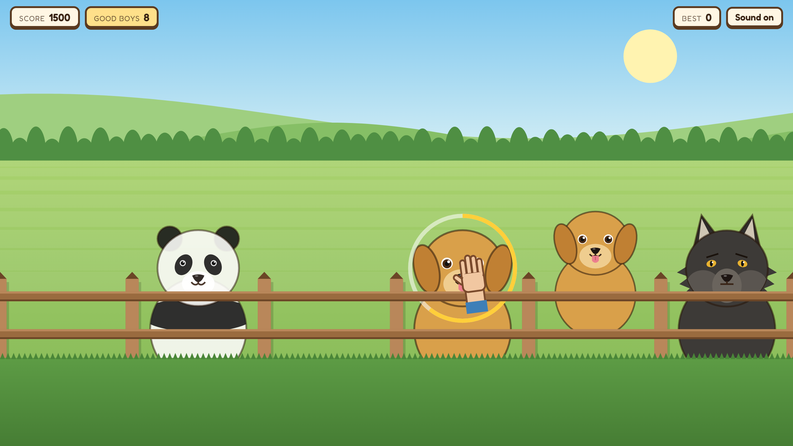

# Can I Pet That Dog?

A browser game based on the "Can I pet that dawg?" meme. Animals walk up to a wooden fence. Pet the dogs. Do not pet the wolves or the bears.

**Play it:** https://tjdoolittle.github.io/can-i-pet-that-dog/

## How to play

- **Pet a dog** by rubbing its head with your cursor until the ring fills, or by clicking it 3 times.
- **Wolves and bears bite.** Rub or click one and it takes your hand. Game over.
- A **growl** means hands off. Brushing past a wolf is fine; rubbing it is not.
- Each dog you pet in a row adds to your streak and your points. Let a dog walk away and the streak resets.
- The longer you last, the faster the animals come and the more of them are wild.

Works with a mouse or a touchscreen.

## The lineup

| Dogs | Wolves | Bears |
| --- | --- | --- |
| Golden Retriever, Dalmatian, Corgi, Pug, Husky, Black Lab, Beagle | Gray Wolf, Arctic Wolf, Timber Wolf | Grizzly, Black Bear, Panda |

Tip: the Husky and the Gray Wolf look a lot alike. Check the eyes and the tongue.

## How it's built

One self-contained `index.html`, no build step and no dependencies:

- All animals, the fence and the scenery are drawn on an HTML canvas in code.
- Sound effects, the forest ambience (breeze, leaves, birdsong) and the growls are synthesized with the Web Audio API.
- The opening audio clip is embedded in the page.
- Your best score is saved in your browser.

## Run it locally

Open `index.html` in any modern browser. That's it.

## Credits

Game by Thomas J. Doolittle. Inspired by the "Can I pet that dawg?" video; the opening audio clip belongs to its original creator and is used here for a non-commercial fan game.
